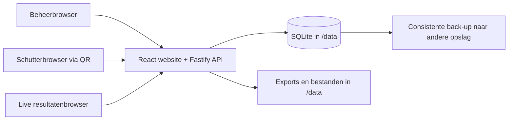

# Projecthandoff: eenvoudige boogschietcompetitiewebsite

> Deploymentbesluit (20 oktober 2026): het
> [Raspberry Pi-installatie- en updateplan](RASPBERRY-PI-PLAN.md) vervangt de
> Docker/Compose-deploymentvoorstellen in dit document. De Pi-image bevat de
> applicatie en Node.js; systemd beheert de processen en SQLite blijft de database.
> De Docker-voorbeelden hieronder zijn historische voorstellen.

## 1. Doel en context

Bouw een nieuwe, zelfstandige website voor het organiseren en scoren van
boogschietcompetities. De toepassing vervangt voor deze gebruiker een beperkte
selectie van Ianseo-functionaliteit. Dit document kan rechtstreeks naar een
nieuw, leeg project worden gekopieerd en als implementatiespecificatie dienen.

**Vaste gebruikerskeuzes:**

- React-frontend met een TypeScript-backend.
- Alle functies werken in een browser: geen mobiele apps of verplichte installatie.
- Beheer en score-invoer horen bij dezelfde website.
- Productie draait op een Raspberry Pi met een 64-bits Linux-installatie.
- Installatie en updates via Docker Compose; gegevens overleven redeployments.
- De wedstrijd moet op het lokale netwerk zonder internetverbinding werken.
- Eenvoudige bediening heeft voorrang op volledige Ianseo-pariteit.

**Gevraagde functies:**

| Omgeving | Functies |
| --- | --- |
| Management frontend/backend | Authenticatie, competitiemanagement, baan/targettoewijzing, targetbeheer, baanmanagement met area's en banen, check-in/inspectie/betaling, resultaatexport, live competitieoverzicht |
| Archer score entry frontend/backend | Resultaatinvoer via QR-code |

Dit document legt een voorgestelde architectuur en werkbare v1-defaults vast.
Waar hieronder een aanname staat, is die niet al door de gebruiker bevestigd.
Het bestaande Ianseo-project, zijn database en zijn Docker-image zijn geen
afhankelijkheden van de nieuwe toepassing.

## 2. Scope en aannames voor v1

1. Eén organisatie beheert meerdere competities op één installatie.
2. V1 ondersteunt individuele kwalificatierondes met configureerbare afstanden,
   series en pijlen. Brackets, teamwedstrijden en eliminaties vallen buiten v1.
3. Eén QR-code geeft toegang tot de scorekaart van een target binnen één
   competitiesessie. De scorer mag de toegewezen schutters op dat target scoren;
   een persoonlijke account per schutter is niet nodig.
4. Een competitie bevat deelnemers, categorieën en minstens één sessie. Eenvoudig
   deelnemersbeheer is noodzakelijk, ook al staat het niet apart in de featurelijst.
5. Betaling betekent registratie van betaald/openstaand/vrijgesteld, geen online
   betaalprovider, boekhouding of facturatiesysteem.
6. Live betekent automatisch bijgewerkte scores en standen, initieel met polling.
7. V1 vereist netwerktoegang naar de Pi voor definitief opslaan. Een lokaal concept
   is geen gesynchroniseerd resultaat. Volledige offline synchronisatie is later werk.

## 3. Technische architectuur

### Stack

| Onderdeel | Keuze |
| --- | --- |
| Taal | TypeScript, strict mode |
| Frontend | React + Vite + React Router |
| Serverstate in frontend | TanStack Query; URL voor filters; lokale React-state voor invoer |
| Styling | Tailwind CSS, eigen kleine set toegankelijke componenten |
| Backend | Node.js op een ondersteunde LTS-versie + Fastify |
| API | REST/JSON onder `/api/v1`, versieerbare gedeelde contracten |
| Validatie | TypeBox-schema's met passende Fastify type provider |
| Database | SQLite + Drizzle ORM/migraties + better-sqlite3 |
| Authenticatie | Server-side sessies in SQLite; opaque sessiecookie; Argon2id voor wachtwoorden |
| Testen | Vitest, Fastify inject-tests, Playwright voor kernflows |
| Packaging | npm workspaces, één lockfile, één productie-image |
| Productie | Eén Node-proces dat de API én de gebouwde React-bestanden serveert |

Controleer bij projectstart de onderlinge compatibiliteit van actuele stabiele
versies, leg die vast in de lockfile en kies concrete basisimageversies. Gebruik
geen zwevende `latest`-tag voor productiereleases. better-sqlite3 en de gekozen
Argon2-library kunnen native dependencies hebben: bouw/installatie gebeurt voor
de doelarchitectuur, niet door Windows-node_modules naar de image te kopiëren.

### Verkeersstroom



Frontend en API gebruiken dezelfde origin. Er is in productie geen Vite-devserver,
geen aparte frontendcontainer en geen Redis nodig. Ontwikkeling gebruikt Vite
met een proxy voor `/api` naar Fastify. De browser gebruikt relatieve API-URL's.

SPA-fallback geldt voor UI-routes, nooit voor onbekende API-routes. Die geven een
JSON 404. Laat ontbrekende statische assets ook een echte 404 teruggeven.

### Projectstructuur

```text
apps/
  web/src/
    features/auth/
    features/competitions/
    features/participants/
    features/venue/
    features/assignments/
    features/check-in/
    features/scoring/
    features/results/
    components/
    lib/
  api/src/
    modules/auth/
    modules/competitions/
    modules/participants/
    modules/venue/
    modules/assignments/
    modules/check-in/
    modules/scoring/
    modules/results/
    modules/backups/
    db/
    plugins/
    server.ts
packages/
  contracts/                  # Request/response-schema's en afgeleide types
  scoring/                    # Pure score- en rangberekening, zonder database/browser
migrations/
tests/e2e/
Dockerfile
compose.yaml
.env.example
README.md
```

Backendmodules bevatten routes, services en databasequeries. Autorisatie en
wedstrijdregels worden op de server afgedwongen. Het gedeelde scoring-package
mag een preview in de UI geven; de server berekent en valideert altijd opnieuw.
De frontend importeert geen database-entiteiten of servergeheimen.

## 4. Terminologie: area's, banen en targets

Voorkom dat fysieke locaties, doelpakken en blazoenen door elkaar worden gebruikt.

| Begrip | Betekenis |
| --- | --- |
| Locatie / Venue | Herbruikbare schietlocatie, bijvoorbeeld de verenigingsaccommodatie |
| Area | Deel van de locatie, bijvoorbeeld Hal A of Buitenveld |
| Baan / Lane | Fysieke schietpositie binnen een area, bijvoorbeeld baan 12 |
| Target | Doelpak gekoppeld aan een baan voor een competitiesessie |
| Target face / Blazoen | Scoringprofiel: type, diameter en toegestane pijlwaarden |
| Slot | Schutterpositie op het target, bijvoorbeeld A, B, C of D |
| Sessie | Geplande groep deelnemers met tijd, area en ronde |
| Serie / End | Eén set van bijvoorbeeld 3 of 6 pijlen |

V1-default: maximaal één actief target per baan per sessie. Meerdere blazoenen
per doelpak worden als face/slotconfiguratie gemodelleerd, niet als extra fysieke
banen. Dezelfde baan kan in een andere sessie opnieuw worden gebruikt.

## 5. Gebruikersrollen en authenticatie

### Rollen

| Rol | Toegang |
| --- | --- |
| Admin | Gebruikers, alle competities, installatie-instellingen en back-upbeheer |
| Organizer | Competitie-instellingen, deelnemers, banen, toewijzingen, scorecorrecties, publicatie en exports van toegewezen competities |
| Desk | Check-in, inspectie en betaalregistratie van toegewezen competities |
| Scorer | Alleen score-invoer voor de targets/sessies waarvoor een QR-grant is afgegeven |
| Public viewer | Alleen gepubliceerde live resultaten en openbare competitiegegevens |

Admin/Organizer/Desk gebruiken accounts. Scorer is een tijdelijke bevoegdheid,
geen reguliere gebruikersrol die een beheeraccount vereist. Competitietoegang
voor personeel staat in een membershiptabel; verifieer die bij iedere resource.

### Sessies

- Geen publieke accountregistratie in v1. Eerste admin via interactieve bootstrap-CLI;
  daarna beheert Admin de accounts en tijdelijke wachtwoordresets.
- Wachtwoorden worden gehasht met Argon2id, nooit versleuteld of plaintext opgeslagen.
- Login genereert een cryptografisch willekeurig sessietoken. Sla alleen de hash
  op in de database en stuur het token als HttpOnly-cookie.
- Sessies hebben absolute en inactiviteitsvervaldata; roteer bij login en wijziging
  van bevoegdheden. Logout, blokkeren en wachtwoordreset maken sessies ongeldig.
- Beheersessie en scoringsessie gebruiken verschillende cookienamen en records;
  QR-inwisseling mag een beheerlogin niet vervangen.
- Cookiebeleid: SameSite=Lax, HttpOnly, Secure bij HTTPS. SameSite vervangt geen
  CSRF-controle: alle cookie-geauthenticeerde mutaties controleren CSRF-token en origin.
- Rate limiting op login, QR-inwisseling en schrijfacties; geen tokens in logs.
- Sessies leven in de persistente database, niet in procesgeheugen. Eventuele
  cookie-/CSRF-geheimen blijven stabiel tussen deployments en staan buiten de image.

## 6. Managementfuncties

### 6.1 Competitiemanagement

- Competities aanmaken, bekijken en bewerken; deelnemers zoeken/toevoegen/wijzigen.
- Naam, omschrijving, locatie, start/einddatum, IANA-tijdzone en publicatiestatus.
- Status: `draft -> open -> running -> completed -> archived`.
- Afzonderlijk `scoringLocked` en `isPublic`; starten maakt een competitie niet
  automatisch openbaar. `completed` en `archived` blokkeren scorerschrijfacties.
- Sessie-instellingen: area, tijd, capaciteit en rondeprofiel.
- Rondeprofiel: fasen/afstanden, blazoen/scoringsprofiel, series per fase,
  pijlen per serie, toegestane waarden en tie-breakvolgorde.
- Categorieën minimaal op basis van boogtype en klasse, met expliciete deelnemertoewijzing.
- DNS/DNF/DSQ-status met reden; rankinggedrag expliciet vastleggen per ondersteund profiel.
- Geen hard delete van competities/deelnemers met scores; archiveer/inactiveer.
- Wijzigingen aan het scoringprofiel worden geblokkeerd zodra scores bestaan.

### 6.2 Targetbeheer en baanmanagement

- Locaties, area's en banen aanmaken, hernoemen en activeren/deactiveren.
- Banen hebben een label/nummer, sorteervolgorde en beschikbaarheidsstatus.
- Target per sessie configureren: baan, label, capaciteit/slots en actief faceprofiel.
- Visueel overzicht per area met bezetting en filters; een toegankelijke lijstweergave
  blijft beschikbaar. Een uitgebreide drag-and-drop-plattegrond is geen v1-vereiste.
- Gebruikte locaties/configuraties niet destructief wijzigen via centrale templates.
  Bewaar competitiegebonden configuraties/snapshots voor historische resultaten.
- Een baan/target met actieve toewijzingen of scores kan niet direct worden verwijderd.

### 6.3 Baan/targettoewijzing

- Deelnemer toewijzen aan sessie, target en slot; overzicht van nog niet toegewezen deelnemers.
- Handmatig verplaatsen en optioneel eenvoudig automatisch vullen op beschikbare slots.
- Databaseconstraints: één deelnemer maximaal één actieve positie per sessie;
  één slot maximaal één actieve deelnemer; één target per baan per sessie.
- Controleer capaciteit en compatibiliteit van ronde, afstand en blazoen op de server.
- Verplaatsingen gebeuren transactioneel. Targetscores blijven aan deelnemer en ronde
  gekoppeld; een verhuizing mag geen scores van een ander target overnemen.
- Bij toewijzingswijziging verhoogt de server de assignmentversie, trekt betrokken
  QR-grants/scoringsessies in en vraagt de organizer nieuwe codes te verspreiden.
- Tijdens een lopende serie wordt een verhuizing geblokkeerd. Een organizer kan eerst
  scoring sluiten en de serie expliciet afhandelen; geen stille herindeling.

### 6.4 Check-in, inspectie en betaling

- Apart bijhouden: aanwezig, inspectie `pending/passed/failed/not_required`, en betaling.
- Deelnamebedrag en betalingen in gehele kleinste valuta-eenheden, met valutacode.
- Betaalregistraties: bedrag, methode, tijd en medewerker. Openstaand/partieel/betaald
  wordt uit het bedrag en de registraties afgeleid; vrijstelling vraagt een reden.
- Geen creditcardgegevens of echte betaalverwerking opslaan.
- Deskdashboard filtert op sessie, categorie, afwezigheid, inspectie en openstaand bedrag.
- Competitiebeleid bepaalt of check-in/inspectie/betaling voorwaarden voor scoring zijn.
  Default: check-in en geslaagde/niet-verplichte inspectie vereist; betaling blokkeert niet.
- Organizer kan een blokkade alleen met reden overrulen. Bewaar dit in de auditlog.

### 6.5 Resultaatexport

- CSV en printvriendelijke resultaatpagina met browserfunctie 'Opslaan als PDF'.
  Een echte servergegenereerde PDF is geen v1-vereiste.
- Filter op categorie, sessie en fase/afstand; kolommen: rang, naam, club,
  categorie, totalen, tie-breakaantallen, pijlen geschoten en resultaatstatus.
- Resultaten bevatten competitie, tijdstip, revisie en label voorlopig/definitief.
- Exporteer een consistente database-snapshot: geen mix van verschillende revisies.
- Publieke export bevat geen geboortedata, betaalgegevens, sessietokens of inspectienotities.
- Bescherm CSV-tekstvelden tegen spreadsheetformules; escape quotes en separators.
- Een resultaatexport is geen herstelbare databaseback-up.

### 6.6 Live view competition

- Managementdashboard: bezetting, check-in, inspectie, betaling en scorevoortgang.
- Publieke read-only pagina: competitiesamenvatting, categorieën en actuele standen.
- Poll iedere 5 seconden zolang de pagina zichtbaar is; gebruik een revisie/ETag en
  pauzeer/vertraag bij verborgen tab of fouten. SSE kan later polling vervangen.
- Toon laatst bijgewerkt, pijlen geschoten, voorlopige/definitieve status en
  netwerkfout/stale-indicator. Een mislukte refresh mag resultaten niet wissen.
- Een schermvullende weergave voor een TV is dezelfde website, geen aparte toepassing.
- Publicatie is opt-in per competitie. Publieke naamweergave is configureerbaar;
  bepaal voor jeugddeelnemers een passende organisatieregel.
- Scores worden in v1 direct zichtbaar zodra succesvol opgeslagen. Een aparte
  officiële verificatie kan de status wijzigen; verberg die status niet.

## 7. Score-invoer via QR

### QR-grant en toegang

1. Organizer maakt per target en sessie een QR-grant aan met een beperkte geldigheidsduur.
2. De code opent bijvoorbeeld `https://archery.example/score#token=<random-token>`.
3. React leest het fragment, verwijdert het met `history.replaceState`, en wisselt
   het token via POST in voor een HttpOnly-scoringsessie plus CSRF-token.
4. De server bewaart alleen tokenhashes. QR-grant bevat competitie, sessie, target,
   assignmentversie, vervaldatum en intrekkingsstatus.
5. Dezelfde afgedrukte QR mag meerdere scoringsessies uitgeven tot hij vervalt of
   wordt ingetrokken; gelijktijdige edits worden met revisies afgevangen.
6. Iedere scoringsrequest controleert de grant opnieuw, inclusief intrekking,
   actuele toewijzingen, wedstrijdstatus en geopende scoringfase. Een cookie alleen
   is nooit voldoende autorisatie.
7. Een doorgestuurde code geeft dezelfde beperkte bevoegdheid. Maak die scope
   duidelijk en bied 'codes intrekken en opnieuw uitgeven' in het beheer.

QR's bevatten geen namen/wachtwoorden en gebruiken geen voorspelbare ID als geheim.
Gebruik minimaal 32 random bytes. Geen third-party scripts/analytics op scoreroutes;
pas `Referrer-Policy: no-referrer` toe. Een optionele competitie-PIN is een latere
extra laag, geen vervanging van de grant.

### Invoerscherm

- Toon competitie, sessie, area, target, slot en namen om verkeerd scoren te voorkomen.
- Grote aanraakknoppen voor toegestane waarden, inclusief `M` en eventueel `X`.
- Per schutter een volledige serie invoeren; subtotalen, totaal en voortgang zichtbaar.
- Geen lege pijlen als nul behandelen. `X`, `10` en `M` zijn expliciete waarden,
  met numerieke betekenis en tie-breakbetekenis uit het rondeprofiel.
- Scorer kan eerdere series lezen; reeds ingediende series zijn voor de scorer
  gesloten. Correcties verlopen via Organizer en vereisen een reden.
- Toon 'Opslaan'/'Opgeslagen' pas op basis van de serverbevestiging. Bij time-out
  blijft de invoer staan en kan dezelfde submission veilig opnieuw worden verstuurd.
- Bewaar optioneel een lokaal concept per grant, deelnemer, ronde en serie, met TTL.
  Wis bij succesvolle opslag, uitloggen of scopewijziging. Meld dat een concept
  alleen op die browser staat en nog niet in de resultaten voorkomt.
- Geen camerascanner nodig: de standaard telefooncamera opent de QR-link.
- Geen internet-CDN's, fonts of externe scripts nodig tijdens de wedstrijd.

### Score-integriteit en gelijktijdige invoer

- Elke submission bevat een UUID `submissionId`, `scorecardId`, `endNumber`,
  volledige pijlwaarden en `expectedVersion`.
- `endNumber` is uniek oplopend binnen de volledige scorekaart, ook over afstanden
  heen. De server leidt de bijbehorende fase en aantallen uit het rondeprofiel af;
  de UI mag daarnaast een serienummer binnen de afstand tonen.
- Eén korte database-transactie controleert bevoegdheden/locks, versie en inhoud,
  schrijft de serie, verhoogt de kaartversie/revisie en schrijft het auditrecord.
- De idempotencyregistratie wordt in dezelfde transactie opgeslagen: dezelfde
  submission met dezelfde inhoud levert dezelfde uitkomst zonder dubbele score.
  Dezelfde ID met andere inhoud is een conflict. Herhaal een bevestigde aanvraag
  zonder nieuwe mutatie, na controle dat de identiteit bij het oorspronkelijke verzoek hoort.
- Een nieuwe submission met verouderde versie geeft HTTP 409. Laat de gebruiker de
  nieuwste kaart laden en verschillen beoordelen; nooit stil last-write-wins.
- Assignmentversie/grantintrekking geeft een herkenbare toegangsfout; de client
  blijft een lokaal concept niet automatisch op een nieuw target indienen.
- Uniek: scorekaart per deelnemer en ronde; serie per scorekaart en serienummer.
- De server controleert exact aantal pijlen, toegestane waarden, seriegrenzen,
  sessie, deelnamevoorwaarden en wedstrijdstatus. Vertrouw geen clienttotaal.

## 8. Scoring en rangschikking

Rondeprofielen zijn expliciete data, geen verspreide `if compound`-regels in UI's.
Begin met een beperkt aantal samen met de gebruiker gevalideerde profielen.
Een configureerbaar voorbeeld is 2 x 30 pijlen op 18 m, 3 pijlen per serie;
dit is geen claim van volledige officiële reglementondersteuning.

- Sommeer numerieke waarden, fase- en competitietotalen en profielspecifieke tellingen.
- Vergelijk bijvoorbeeld totaal, aantal 10-en en aantal X-en alleen als dat profiel
  die volgorde voorschrijft. Indoor en outdoor kunnen verschillende regels vereisen.
- Bij resterende gelijke score blijft de rang gedeeld. Alfabetische sortering mag
  de weergave stabiliseren, maar mag geen sportieve tie-break worden.
- Beheerwijzigingen gebruiken eveneens een revisie waar gelijktijdig overschrijven
  gevolgen heeft, bijvoorbeeld bij toewijzingen, check-in en wedstrijdinstellingen.
- Toon bij onvolledige resultaten het aantal geschoten pijlen. Verschillende
  voortgang maakt een voorlopige rang geen definitieve uitslag.
- DNS/DSQ krijgen standaard geen normale rang; DNF met gedeeltelijke score wordt
  zichtbaar gemarkeerd. Valideer definitief gedrag met de gekozen wedstrijdregels.
- Alleen een expliciete Organizer-actie maakt een competitie definitief en sluit
  scoring. Heropenen of corrigeren daarna vraagt reden en verhoogt resultaatrevisie.

## 9. Datamodel

Gebruik UUID's, UTC-timestamps en foreign keys. Toon tijden in de tijdzone van de
competitie. Gebruik soft delete/statussen waar historie bestaat.

| Entiteit | Belangrijkste velden/relaties |
| --- | --- |
| User | email uniek, naam, passwordHash, globale adminstatus, active |
| StaffSession | userId, tokenHash uniek, createdAt, lastSeenAt, expiresAt |
| Competition | naam, locatie, datums, timezone, status, isPublic, scoringLocked, resultRevision |
| CompetitionMember | competitionId + userId uniek, organizer/desk |
| Venue / Area / Lane | fysieke hiërarchie, label/nummer, sorteervolgorde, active |
| FaceProfile | type, diameter, waardemapping, toegestane symbolen, versie |
| Round / RoundStage | competitiegebonden profiel, afstanden, series, pijlen, tie-breakregels |
| Category | competitionId, naam, boogtype/klasse |
| Participant | competitionId, naam, club, categorie, resultaatstatus, optional athleteId |
| AttendanceInspection | participantId, check-in, inspectiestatus, medewerker/tijd, notities, override |
| EntryFee / Payment | participantId, bedrag minor units, valuta, methode, actor/tijd, vrijstelling |
| CompetitionSession | competitionId, roundId, areaId, tijd, scoringstatus en geopende fase |
| SessionTarget | sessionId, laneId, targetlabel, faceprofiel, slotcapaciteit, assignmentVersion |
| Assignment | participantId, sessionId, targetId, slot; unieke actieve deelnemer/slot |
| QrGrant | tokenHash, scope, assignmentVersion, expiresAt, revokedAt |
| ScoringSession | tokenHash, grantId, verval en intrekkingsstatus |
| Scorecard | participantId, roundId, version, verificatiestatus |
| EndScore / ArrowScore | scorecardId, stageId, endNumber, arrowIndex, symbool, serverwaarde |
| Submission | id uniek, actor/sessie, requestHash, oorspronkelijke uitkomst |
| AuditEvent | actorsoort/id, actie, resource, before/after of wijzigingsdetails, reden, timestamp |
| SchemaMigration | toegepaste migraties, versie/checksum |

Alle childresources moeten daadwerkelijk tot dezelfde competitie behoren.
Handhaaf dit met foreign keys/composiete constraints waar mogelijk en
transactionele services waar nodig. Accepteer niet blind een mix van geldige ID's.
Auditlog bevat geen wachtwoorden of ruwe tokens. Bewaar scorecorrectiehistorie
ook wanneer de actuele score wordt aangepast.

SQLite: `foreign_keys=ON`, WAL-modus en een begrensde busy timeout. Houd transacties
kort. Geen exports, netwerkverzoeken of grote berekeningen binnen een schrijftransactie.
V1 draait als één appinstantie; geen meerdere replicas op één SQLite-bestand en
geen database op een SMB/NFS-share. Test schrijfpieken voor daadwerkelijk wedstrijdgebruik.

## 10. API-oppervlak

Onderstaande routes zijn een ontwerpcontract; resource-ID's geven nooit op zichzelf toegang.

| Groep | Voorbeelden |
| --- | --- |
| Auth | `POST /auth/login`, `POST /auth/logout`, `GET /auth/me`, `GET /auth/csrf` |
| Accounts | `GET/POST /users`, `PATCH /users/:id`, `POST /users/:id/reset-password` |
| Competities | `GET/POST /competitions`, `GET/PATCH /competitions/:id`, `POST /competitions/:id/transitions` |
| Personeel | `GET/POST /competitions/:id/members`, `DELETE /competitions/:id/members/:userId` |
| Rondes/categorieën | `GET/POST /competitions/:id/rounds`, `GET/POST /competitions/:id/categories`, overeenkomstige PATCH-routes |
| Deelnemers | `GET/POST /competitions/:id/participants`, `PATCH /participants/:id` |
| Locatie | `GET/POST /venues`, `GET/POST /venues/:id/areas`, `GET/POST /areas/:id/lanes`, overeenkomstige PATCH-routes |
| Sessies/targets | `GET/POST /competitions/:id/sessions`, `PATCH /sessions/:id`, `GET/POST /sessions/:id/targets`, `PATCH /targets/:id` |
| Toewijzingen | `GET /sessions/:id/assignments`, `PUT /sessions/:id/assignments` met atomische batch en revisie |
| QR-beheer | `POST /targets/:id/qr-grants`, `POST /qr-grants/:id/revoke`, `GET /sessions/:id/qr-print` |
| Desk | `PATCH /participants/:id/check-in`, `PATCH /participants/:id/inspection`, `POST /participants/:id/payments`, `POST /participants/:id/payment-adjustments` |
| Scorer | `POST /scoring/exchange`, `GET /scoring/context`, `GET /scoring/scorecards/:id`, `PUT /scoring/scorecards/:id/ends/:number` |
| Scorecontrole | `GET /competitions/:id/scoring-progress`, `POST /scorecards/:id/verify`, `PATCH /scorecards/:id/ends/:number` met reden/versie |
| Resultaten | `GET /competitions/:id/results`, `GET /competitions/:id/exports/results.csv` |
| Publiek | `GET /public/competitions/:id`, `GET /public/competitions/:id/results` |
| Operatie | `GET /health/live`, `GET /health/ready` |

Alle routes staan onder `/api/v1`. Valideer params, query, body en response.
Public routes hebben een eigen beperkte responsevorm. Betaalaanpassingen zijn
correctieregistraties, geen verwijdering van de oorspronkelijke betaling.

Gebruik consistente fouten met `code`, `message`, optionele `fieldErrors` en
`requestId`: 400 invoer, 401 geen sessie, 403 onvoldoende bevoegdheid, 404 niet
beschikbaar, 409 versie/idempotencyconflict en 429 rate limit. Stuur geen interne
stacktraces naar browsers. Laat UI's expliciet omgaan met verlopen sessies en 409's.

## 11. Frontendroutes en gebruikerservaring

```text
/login
/manage/competitions
/manage/competitions/:id/overview
/manage/competitions/:id/settings
/manage/competitions/:id/participants
/manage/competitions/:id/sessions
/manage/competitions/:id/targets
/manage/competitions/:id/assignments
/manage/competitions/:id/check-in
/manage/competitions/:id/results
/manage/venues
/manage/users
/score
/live/:competitionId
```

- Management: desktopvriendelijk, maar check-in en scorecorrectie bruikbaar op tablet.
- Scoring: mobile-first, grote knoppen, duidelijke actieve schutter en serie,
  zichtbare opslagstatus, geen dicht opeengepakte Ianseo-menu's.
- Navigatie volgt de workflow: competitie -> deelnemers -> targets -> toewijzing
  -> check-in -> scoring -> resultaten.
- Nederlandse UI als v1-default; teksten centraal houden voor latere vertalingen.
- Labels, toetsenbordbediening, zichtbare focus, voldoende contrast; status nooit
  alleen met kleur aangeven.
- TanStack Query bewaart serverdata. Invalideer relevante queries na mutaties;
  belangrijke writes tellen pas als opgeslagen na serverbevestiging.

## 12. Raspberry Pi, Docker en persistente data

### Productie-installatie

- Ondersteunde Pi met 64-bits Raspberry Pi OS/Debian, Docker Engine en Compose v2.
- Eén appcontainer, native ARM64-image. Bouw ook AMD64 voor ontwikkeling indien gewenst.
- Multi-stage build: dependencies/buildtools, daarna alleen runtime, productiepackages,
  migraties en React-dist. Draai als non-root en zorg dat `/data` schrijfbaar is.
- Frontendbestanden blijven in de image; alleen veranderlijke gegevens in het volume.
- Pi hoeft geen TypeScript of frontend te compileren bij installatie/update.
- Maak de definitieve capaciteitskeuze na een test op het beschikbare Pi-model,
  met het verwachte aantal gelijktijdige scorers en live viewers.

Voorbeeld van het te bouwen deploymentcontract, geen bestaande gepubliceerde image:

```yaml
services:
  app:
    image: ghcr.io/YOUR_ORG/archery:1.0.0
    restart: unless-stopped
    init: true
    ports:
      - "${APP_PORT:-8080}:3000"
    environment:
      NODE_ENV: production
      HOST: 0.0.0.0
      PORT: "3000"
      DATABASE_PATH: /data/archery.sqlite
      UPLOADS_PATH: /data/uploads
      BACKUP_PATH: /data/backups
      PUBLIC_BASE_URL: ${PUBLIC_BASE_URL:?Set a browser-reachable URL}
      APP_SECRET: ${APP_SECRET:?Set a persistent random secret}
      SESSION_COOKIE_SECURE: ${SESSION_COOKIE_SECURE:-true}
    volumes:
      - archery-data:/data
    stop_grace_period: 30s
    healthcheck:
      test: ["CMD", "node", "dist/healthcheck.js"]
      interval: 30s
      timeout: 5s
      start_period: 30s
      retries: 3

volumes:
  archery-data:
    external: true
    name: archery-data
```

Implementeer de genoemde env-vars, validatie en `dist/healthcheck.js` daadwerkelijk.
De healthcheck gebruikt localhost en `/health/ready`; geen login of scoremutatie.
Readiness betekent dat de database bereikbaar is en migraties overeenkomen.

`PUBLIC_BASE_URL` is de URL die telefoons kunnen bereiken, inclusief poort en
eventueel HTTPS. Gebruik runtimeconfiguratie voor QR-generatie; bouw geen Pi-IP
in React-assets. Gebruik een stabiel lokaal adres/hostname of DHCP-reservering.

HTTPS heeft de voorkeur bij gebruik van wachtwoorden en scoringtokens. TLS kan
worden afgehandeld door een bestaande reverse proxy of optionele Caddy-container;
dat is niet nodig als onderdeel van de applicatiearchitectuur zelf. Documenteer
lokale certificaatvertrouwensinstellingen. Op een geïsoleerd LAN kan expliciet
HTTP worden gekozen met `SESSION_COOKIE_SECURE=false`; die verbinding versleutelt
geen wachtwoorden of scoreverkeer. Activeer proxyvertrouwen alleen voor de bedoelde proxy.

### Installatie en update

```sh
# Eenmalig: .env invullen, volume maken en registrylogin indien nodig.
docker volume create archery-data
docker compose pull
docker compose run --rm app node dist/cli.js migrate
docker compose run --rm -it app node dist/cli.js create-admin
docker compose up -d --wait
```

De image implementeert deze CLI-commando's; wachtwoorden worden interactief
gevraagd en komen niet in shellhistory. Initialisatie maakt geen demo-admin aan.

Veilige updatevolgorde:

1. Stop nieuwe score-invoer en voer een consistente back-up uit.
2. Stop de app, wijzig de image naar een concrete release en download die.
3. Voer migraties uit met de nieuwe image; start alleen bij succes.
4. Start met `docker compose up -d --wait` en controleer read/write en resultaten.

Een startup-check mag pending migraties melden; geen ongevraagde destructive
reset of verborgen seeds bij iedere start. Eén migrator tegelijk. Bij mislukte
migratie niet toch met een gedeeltelijk compatibel schema starten.

Het externe volume blijft behouden bij containervervanging, Compose-down en
projectmapwijzigingen. Een imageupdate vervangt geen bestaande data. Migratie naar
een andere Pi vereist expliciet back-up/restore; volumes worden niet automatisch gekopieerd.
Image-rollback is alleen veilig als het schema compatibel is; anders herstel ook
de pre-updateback-up en benoem het verlies van wijzigingen sinds die back-up.

### Back-up en herstel

- Implementeer een CLI die SQLite's online backup API gebruikt, met metadata over
  appversie, schemaversie en tijdstip. Kopieer niet zomaar een actieve WAL-database.
- Back-up omvat database, noodzakelijke uploads en apart beveiligde configuratie/geheimen.
  Maak een gecombineerde snapshot tijdens gepauzeerde writes als uploads betrokken zijn.
- Lokale `/data/backups` is staging, geen bescherming tegen defecte Pi-opslag.
  Kopieer regelmatig naar andere fysieke opslag; configureer retentie en foutmelding.
- Restore gebeurt met gestopte app, in een leeg testvolume of na expliciete keuze
  voor vervangen. Controleer database-integriteit en benodigde rechten vóór starten.
- Documenteer en test herstel op een nieuwe installatie, niet alleen het maken van back-ups.
- Handel SIGTERM netjes af: geen nieuwe requests, actieve writes afronden en database sluiten.

## 13. Kwaliteit en acceptatiecriteria

Test businessregels en echte risico's. Minimale acceptatieset:

1. Bootstrap-admin kan inloggen; geblokkeerde gebruiker kan niet verder; logout
   trekt sessie in. Gebruikers zonder membership kunnen een competitie niet wijzigen.
2. Desk kan check-in/inspectie/betaling registreren maar geen wedstrijdregels aanpassen.
3. Dubbele targetslots, dubbele deelnemertoewijzing en ongeldige facecombinaties
   worden ook bij gelijktijdige requests geweigerd.
4. QR opent op een telefoon de juiste targetkaart zonder reguliere login.
   Ongeldige/verlopen/ingetrokken codes geven geen scoretoegang.
5. Scorer kan geen andere target/deelnemer benaderen door een API-ID te wijzigen.
   Een herindeling trekt bestaande toegang daadwerkelijk in.
6. Server weigert illegale pijlwaarden/aantallen en writes naar gesloten scoring.
7. Twee browsers op dezelfde kaart: eerste opslag slaagt, tweede krijgt een conflict.
   Retry van exact dezelfde submission telt niet dubbel, ook na een netwerk-time-out.
8. Een geweigerde save verschijnt nooit als opgeslagen. Een concept overleeft een
   onbedoelde refresh op dezelfde browser en wordt niet aan een andere grant gekoppeld.
9. X/10/M, fase-totalen, gelijke rangen en resultaatstatussen hebben vaste testfixtures
   voor ieder ondersteund rondeprofiel. Afgekeurde writes veranderen geen ranking.
10. Scorecorrectie vraagt bevoegdheid en reden en bewaart voor/na-historie.
11. Live view toont nieuwe scores binnen ongeveer 5 seconden onder normaal gebruik;
    publiek ziet nooit privégegevens of niet-gepubliceerde competities.
12. CSV/printweergave komen overeen met de gekozen resultaatrevisie en categorie.
13. Na containervervanging blijven deelnemers, scores, betalingen, grants en geldige
    sessies bestaan. Geen herinitialisatie bij een tweede start.
14. Back-up kan in een nieuw volume worden hersteld met identieke resultaten;
    migratiefouten leiden niet tot een stil geresette database.
15. De gebouwde ARM64-image draait op de doel-Pi. Voer daar een piektest uit met
    gelijktijdige submissions, retries en live viewers; leg aantallen en latency vast.

Logs zijn gestructureerd met request-ID's, zonder wachtwoorden, QR-tokens of
onnodige persoonsgegevens. Meet mislukte saves, conflicten, database-busy-fouten,
back-upstatus en schijfruimte. Geen externe monitoringdienst nodig voor v1.

## 14. Implementatievolgorde

1. **Fundament:** workspace, schema's, migrations, Fastify/React, CI, ARM64-image,
   volume, healthcheck en bootstrap-auth. Bewijs direct dat redeploy data behoudt.
2. **Wedstrijd voorbereiden:** competitie, ronde/categorie, deelnemers, venue/area/
   baan, sessietargets en transactionele toewijzingen.
3. **Desk:** check-in, inspectie, betaalregistraties en scorer-toelatingsbeleid.
4. **Verticale scoreflow:** QR-grant -> exchange -> kaart -> serie opslaan ->
   berekend resultaat. Bouw autorisatie, idempotency en conflictbehandeling hierbij.
5. **Wedstrijd volgen:** scorevoortgang, correcties/verificatie, live view en exports.
6. **Operationeel afronden:** consistente back-up/restore, migratieprocedure,
   toegankelijke mobiele UX en testwedstrijd op de Pi.

Elke stap levert werkende frontend én backend op. Maak geen maandenlange
generieke frameworklaag of volledige API voordat de eerste scoreflow bruikbaar is.

## 15. Bewust buiten v1

- Native mobiele apps en verplichte PWA-installatie.
- Volledige offline submissionqueue met automatische conflictsynchronisatie.
- Head-to-head-brackets, round robin, teamcompetities en shoot-offs.
- Volledige WA/federatiereglementdekking, records en Ianseo-importcompatibiliteit.
- Online betalingen, facturen, e-mail/SMS en publieke zelfregistratie.
- Microservices, Redis, Kubernetes en meerdere appreplicas.
- Uitgebreide venue drawing tools en broadcastintegraties.

## 16. Nog te bevestigen productkeuzes

Blokkeer het technische fundament hier niet op; houd aannames zichtbaar.

- Welke Pi, hoeveel RAM en hoeveel gelijktijdige schutters/targets/live viewers?
- Welke concrete wedstrijdprofielen, categorieën en tie-breakregels worden eerst ondersteund?
- Is een QR per target zoals voorgesteld voldoende, of moet elke schutter zijn
  eigen code krijgen? Dat verandert de grant-scope en scoring-UX.
- Welke termen bedoelt de organisatie precies met baan, target en area?
- Moet één persoon meerdere rondes/sessies schieten met afzonderlijke uitslagen?
- Is printen naar PDF voldoende of zijn downloadbare, vast opgemaakte PDF's vereist?
- Wordt de website alleen op LAN gebruikt of ook via internet, en hoe wordt TLS geregeld?
- Welke publicatienaamregels gelden voor deelnemers, vooral jeugd?

## 17. Startinstructie voor het nieuwe project

> Gebruik dit document als architectuur- en productspecificatie. Bouw een nieuwe
> React + TypeScript + Fastify-toepassing met één productiecontainer en SQLite
> in een extern Docker-volume. Implementeer de gevraagde beheerfuncties en
> QR-score-invoer als samenhangende browserflows. Begin met fase 1 en werk in
> verticale stappen. Houd aannames expliciet, gebruik actuele compatibele versies,
> en voer de beschreven tests uit. Hergebruik geen afhankelijkheden of database
> uit het oude Ianseo-project. Breid de scope niet uit naar apps, brackets of
> microservices zonder nieuwe productkeuze.

## 18. Technische referenties

Deze links onderbouwen technologiegedrag; de productkeuzes hierboven zijn het
ontwerpvoorstel voor deze toepassing.

- [Fastify TypeScript](https://fastify.dev/docs/latest/Reference/TypeScript/)
- [Fastify validatie en serialisatie](https://fastify.dev/docs/latest/Reference/Validation-and-Serialization/)
- [Vite productiebuild](https://vite.dev/guide/build)
- [SQLite toepassingsgebieden en schrijfconcurrency](https://www.sqlite.org/whentouse.html)
- [SQLite WAL](https://www.sqlite.org/wal.html)
- [SQLite online backup API](https://www.sqlite.org/backup.html)
- [Docker multi-platform builds](https://docs.docker.com/build/building/multi-platform/)
- [Docker persistente volumes](https://docs.docker.com/engine/storage/volumes/)
- [Docker Compose down en externe volumes](https://docs.docker.com/reference/cli/docker/compose/down/)
- [OWASP sessiebeheer](https://cheatsheetseries.owasp.org/cheatsheets/Session_Management_Cheat_Sheet.html)
- [OWASP CSRF-preventie](https://cheatsheetseries.owasp.org/cheatsheets/Cross-Site_Request_Forgery_Prevention_Cheat_Sheet.html)
