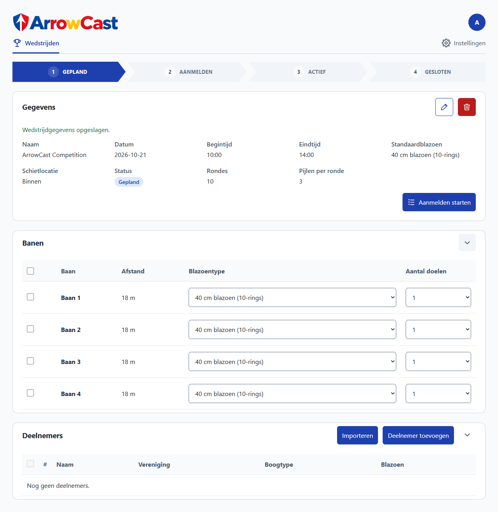

# 🏹 ArrowCast

### Digitaal scorebeheer voor boogschietverenigingen

**Minder administratie. Meer aandacht voor het boogschieten.**

ArrowCast is een digitaal systeem waarmee boogschietverenigingen eenvoudig wedstrijden kunnen organiseren, deelnemers kunnen indelen en scores kunnen bijhouden.

Van het aanmelden van schutters tot het invoeren van de laatste pijl: ArrowCast helpt je om het wedstrijdverloop overzichtelijk en soepel te laten verlopen.

Schutters en vrijwilligers voeren scores in via hun eigen smartphone. De wedstrijdleiding kan de resultaten direct volgen, zonder papieren scorebriefjes te hoeven verzamelen of scores handmatig over te typen.

Ook het publiek kan live meekijken met de tussenstanden, zodat iedereen de wedstrijd op de voet kan volgen.

ArrowCast is ontwikkeld met het verenigingsleven in gedachten: **praktisch, overzichtelijk en eenvoudig te bedienen, ook zonder technische kennis.**

> **🚧 Projectstatus**
>
> ArrowCast is nog in ontwikkeling. De belangrijkste functies voor wedstrijdbeheer en score-invoer zijn aanwezig. De vereenvoudigde installatie op een Raspberry Pi wordt verder getest en uitgebreid.

---

## 🎯 Wat kun je met ArrowCast?

### 📅 Wedstrijden organiseren

Maak wedstrijden aan en stel eenvoudig in hoe er geschoten wordt.

- Kies de wedstrijddatum en de begin- en eindtijd.
- Selecteer de beschikbare schietbanen en afstanden.
- Stel de gebruikte blazoenen in.
- Bepaal het aantal rondes en pijlen per ronde.
- Volg de wedstrijd van voorbereiding tot afsluiting.

### 👥 Deelnemers beheren

Voeg schutters toe aan wedstrijden, inclusief hun vereniging en boogtype.

ArrowCast kan deelnemersgegevens ophalen uit de openbare wedstrijdinformatie op **mijn.handboogsport.nl**. Zo hoef je veel namen, bondsnummers en verenigingen niet opnieuw in te voeren.

Ontbreekt een schutter? Dan kun je deze ook handmatig toevoegen.

### 🎯 Automatische baanindeling

Tijdens het aanmelden van deelnemers helpt ArrowCast bij het verdelen van schutters over de beschikbare schietplaatsen.

Het systeem houdt rekening met de ingestelde blazoenen, beschikbare plaatsen en een evenwichtige indeling.

De wedstrijdleiding kan zien wie aanwezig is en de indeling waar nodig opnieuw laten berekenen.

### 📱 Scores invoeren met een smartphone

Iedere schietbaan krijgt een eigen QR-code.

Door deze code te scannen, opent de score-invoer direct in de browser van een smartphone of tablet.

- **Geen aparte app nodig.**
- **Geen persoonlijk account nodig voor score-invoerders.**
- Duidelijke invoer van de geschoten pijlen.
- Scores van eerdere rondes bekijken.
- Foutieve scores corrigeren zolang de score-invoer beschikbaar is.

Scores worden opgeslagen in het centrale systeem zodra de invoer bevestigd is.

### Persoonlijk scorelogboek

Naast wedstrijden is er een doorlopend **Scorelogboek** voor individuele clubtrainingen, zonder baanregistratie of einddatum.

- Open het tabblad **Scorelogboek** in het beheerportal en druk de vaste QR-code af.
- Na het scannen kiest de schutter een naam uit de bestaande deelnemerslijst. Bij het eerste gebruik maakt diegene een pincode van 4 tot 6 cijfers aan; daarna is deze pincode nodig voor score-invoer.
- Een lijstje bestaat uit 10 series van 3 pijlen. **Opslaan** bewaart een concept. Bij verversen blijven in hetzelfde browsertabblad ook nog niet opgeslagen pijlen en de geselecteerde ronde behouden.
- Ook de laatste serie wordt eerst opgeslagen. Daarna verschijnt **Beëindigen**. De definitieve score krijgt een datum en tijd en telt mee in het overzicht. **Opnieuw proberen** opent een nieuw lijstje voor dezelfde persoon.
- Het beheertabblad toont per persoon de gemiddelde score per lijstje, het gemiddelde per pijl en de hoogste score. Klik op een naam voor de historie.

De logboekscores en gehashte pincodes staan in aparte tabellen; er worden geen wedstrijden, baanindelingen of wedstrijdregistraties voor aangemaakt. De QR-link `/scores/logbook` verloopt niet en gebruikt hetzelfde bereikbare websiteadres als de QR-codes voor wedstrijden.

### 🏆 Live scores en tussenstanden

Tijdens de wedstrijd heeft de wedstrijdleiding een actueel overzicht van de resultaten.

Je ziet onder andere hoeveel rondes zijn ingevoerd, de behaalde punten en het gemiddelde per pijl.

**Ook het publiek kan live meegenieten!**

Doordat scores direct worden bijgewerkt, kunnen actuele tussenstanden en resultaten op bijvoorbeeld een groot scherm in de kantine of bij de wedstrijdlocatie worden getoond.

Zo kunnen toeschouwers, supporters en andere schutters de wedstrijd op de voet volgen en zien hoe de ranglijst zich ontwikkelt.

**Meer wedstrijdbeleving voor het publiek, minder administratief werk voor de organisatie.**

---

## 📋 Hoe werkt een wedstrijd met ArrowCast?

Een wedstrijd organiseren bestaat uit vijf eenvoudige stappen.

### 1. Bereid de wedstrijd voor

De wedstrijdleiding maakt een wedstrijd aan en kiest welke banen gebruikt worden, op welke afstanden geschoten wordt en welke blazoenen beschikbaar zijn.

Ook het aantal rondes en pijlen per ronde wordt ingesteld.

### 2. Voeg de deelnemers toe

Zoek deelnemers op naam of bondsnummer en voeg ze toe aan de wedstrijd. Selecteer voor iedere schutter het juiste boogtype.

Tijdens het aanmelden registreer je welke schutters aanwezig zijn. ArrowCast helpt vervolgens om de schietplaatsen te verdelen.

### 3. Deel de QR-codes uit

ArrowCast maakt voor iedere schietbaan een QR-code.

Deze codes kun je afdrukken en bij de betreffende banen neerleggen of ophangen.

Een vrijwilliger of schutter scant de code met een smartphone en krijgt toegang tot de score-invoer van die baan.

### 4. Start de wedstrijd

Tijdens de wedstrijd worden de geschoten pijlen op de telefoon ingevoerd.

De ingevoerde scores worden naar ArrowCast verzonden en centraal opgeslagen. De wedstrijdleiding kan de voortgang volgen.

Ook kunnen de actuele tussenstanden aan het publiek worden getoond, bijvoorbeeld op een scherm in de kantine.

Is er een fout gemaakt? Dan kan een eerder ingevoerde ronde worden aangepast zolang de wedstrijd actief is en de score-invoer niet is vergrendeld.

### 5. Sluit de wedstrijd af

Wanneer alle scores zijn ingevoerd en gecontroleerd, kan de wedstrijd worden afgesloten.

De resultaten blijven in ArrowCast bewaard. Na het afsluiten is score-invoer via de QR-codes niet meer mogelijk.

---

## 📦 Wat heb je nodig?

ArrowCast is ontworpen om lokaal op een kleine computer te kunnen draaien, bijvoorbeeld een **Raspberry Pi**.

Een Raspberry Pi is een compacte computer die weinig stroom verbruikt en geschikt is om het systeem tijdens wedstrijden beschikbaar te stellen.

Voor de beoogde opstelling heb je nodig:

| Benodigdheid | Waarvoor? |
|---|---|
| Raspberry Pi | Hierop draait ArrowCast |
| Voeding en microSD-kaart | Om de Raspberry Pi te starten |
| Laptop, tablet of computer | Voor het wedstrijdbeheer |
| Smartphones of tablets | Voor de score-invoer bij de schietbanen |
| Wifi-verbinding | Om apparaten met ArrowCast te verbinden |
| Printer (optioneel) | Om QR-codes voor de banen af te drukken |
| Groot scherm (optioneel) | Om live tussenstanden aan het publiek te tonen |

De Raspberry Pi-versie is bedoeld om een eigen wifi-netwerk met de naam **ArrowCast** beschikbaar te stellen. Apparaten kunnen daarmee verbinding maken om het systeem te gebruiken.

**Let op:** Voor het versturen van scores is een werkende netwerkverbinding met ArrowCast nodig. Scores die nog niet door het systeem bevestigd zijn, worden niet automatisch offline bewaard.

---

## 🚀 ArrowCast installeren

De installatie op een Raspberry Pi is nog in ontwikkeling en wordt verder getest.

Er wordt gewerkt aan een installatie waarbij je:

1. ArrowCast downloadt.
2. Het systeem op een microSD-kaart zet.
3. De microSD-kaart in de Raspberry Pi plaatst.
4. De Raspberry Pi opstart.
5. Verbinding maakt met het ArrowCast-wifinetwerk.
6. De beheeromgeving opent in je webbrowser.

De huidige Raspberry Pi-image is bedoeld voor testgebruik en moet nog op een fysieke Raspberry Pi worden gecontroleerd voordat deze voor echte wedstrijden wordt ingezet.

De technische installatie-instructies zijn te vinden in de [GitHub-repository](https://github.com/tcbenkhard/Arrowcast).

### Eerste keer inloggen

Bij een correct geïnstalleerde Raspberry Pi-versie is de beheeromgeving bereikbaar via:

`http://10.42.0.1/admin`

Verbind eerst met het wifi-netwerk **ArrowCast**.

De standaardgegevens voor de eerste aanmelding zijn:

- **Gebruikersnaam:** `admin`
- **Wachtwoord:** `admin`

Bij de eerste aanmelding moet je een eigen wachtwoord instellen.

---

## ❓ Veelgestelde vragen

### Moet iedere schutter een app installeren?

Nee. ArrowCast werkt via een webbrowser. Een QR-code scannen is voldoende om de score-invoer voor een baan te openen.

### Hebben score-invoerders een account nodig?

Nee. De QR-code geeft toegang tot de betreffende schietbaan. De wedstrijdleiding gebruikt wel een beveiligd beheeraccount.

### Kan ik een verkeerd ingevoerde score aanpassen?

Ja. Tijdens een actieve wedstrijd kun je eerder ingevoerde rondes corrigeren, zolang de score-invoer niet is vergrendeld.

### Kunnen meerdere telefoons tegelijk worden gebruikt?

Ja. Verschillende banen kunnen tegelijkertijd scores invoeren.

Ook kan dezelfde baan vanaf meerdere apparaten worden geopend. ArrowCast controleert daarbij of gegevens niet ongemerkt worden overschreven.

### Kan het publiek de wedstrijd live volgen?

Ja! Doordat de scores tijdens de wedstrijd worden bijgewerkt, kunnen actuele tussenstanden en resultaten aan het publiek worden getoond.

Bijvoorbeeld op een televisie of groot scherm in de kantine of bij de wedstrijdlocatie.

Zo kunnen supporters, toeschouwers en andere schutters de ontwikkelingen tijdens de wedstrijd volgen.

### Werkt ArrowCast zonder internet?

ArrowCast is ontworpen om lokaal te draaien.

De Raspberry Pi-opstelling kan een eigen wifi-netwerk aanbieden, zodat voor normaal lokaal wedstrijdgebruik geen externe internetverbinding nodig hoeft te zijn.

Voor het ophalen van deelnemersgegevens via handboogsport.nl is wel internettoegang nodig.

### Wat gebeurt er als een telefoon uitvalt?

Scores die door ArrowCast zijn bevestigd, blijven centraal opgeslagen. Je kunt de QR-code opnieuw scannen om verder te gaan.

Let op: invoer die nog niet succesvol is opgeslagen, kan verloren gaan.

### Kan ik ArrowCast gebruiken voor regiowedstrijden?

ArrowCast ondersteunt het organiseren van wedstrijden en het importeren van deelnemersinformatie uit openbare regiocompetitiegegevens.

Een officiële koppeling voor het automatisch aanleveren van uitslagen aan de KHSN of handboogsport.nl is nog niet beschikbaar.

Controleer daarom zelf welke aanleverwijze jouw wedstrijd vereist.

---

## 🔐 Privacy en gegevens

ArrowCast bewaart wedstrijdgegevens in een lokale database op de computer waarop het systeem draait.

Daaronder kunnen namen van schutters, bondsnummers, verenigingen, wedstrijdindelingen en scores vallen.

De beheeromgeving is beveiligd met een gebruikersnaam en wachtwoord. Score-invoerders krijgen alleen toegang via een QR-code voor hun baan.

Verenigingen blijven zelf verantwoordelijk voor het zorgvuldig omgaan met persoonsgegevens en het maken van back-ups.

Een eenvoudige functie voor back-ups en herstel via de beheeromgeving is onderdeel van de verdere ontwikkeling.

---

## 🛠️ Ontwikkeling

ArrowCast wordt actief ontwikkeld. Niet alle geplande functies zijn al beschikbaar of volledig getest.

Er wordt onder andere gewerkt aan:

- Een eenvoudiger installatieproces voor Raspberry Pi.
- Back-ups en het terugzetten van wedstrijdgegevens.
- Eenvoudigere updates zonder technische kennis.
- Verdere verbeteringen op basis van ervaringen tijdens wedstrijden.

Heb je een idee, loop je tegen een probleem aan of mis je een functie? Feedback van verenigingen en wedstrijdorganisatoren is welkom!

---

## ✉️ Contact en ondersteuning

Heb je vragen over ArrowCast? Wil je het systeem gebruiken bij jouw boogschietvereniging, of heb je suggesties voor verbeteringen?

**Neem gerust contact op!**

📧 **E-mail:** [arrowcast@benkhard.nl](mailto:arrowcast@benkhard.nl)

🐛 **Probleem melden of een idee delen:** [GitHub Issues](https://github.com/tcbenkhard/Arrowcast/issues)

Ook als je geen technische kennis hebt, kun je gewoon een e-mail sturen. Vragen, ervaringen en ideeën van verenigingen helpen om ArrowCast verder te verbeteren.

---

## 💻 Voor technisch geïnteresseerden

ArrowCast is een project waarvan de broncode openbaar beschikbaar is op GitHub.

De software bestaat uit een webinterface en een centraal systeem voor het beheren en opslaan van wedstrijden en scores.

Meer technische informatie, de broncode en instructies voor ontwikkelaars zijn beschikbaar in de [ArrowCast-repository](https://github.com/tcbenkhard/Arrowcast).

---

**ArrowCast — Voor schutters, door een schutter.** 🏹
