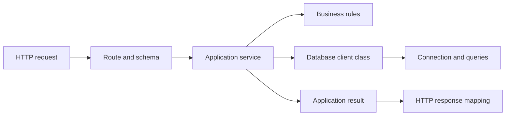

# Code organization

Keep each file focused on one reason to change. The project uses feature modules rather than a global hierarchy of controllers, services and repositories.

## API boundaries



- `app.ts` owns process resources: database lifetime, maintenance handling, health and application error translation. `DatabaseConnection` owns SQLite setup, migrations and connection cleanup.
- `api.ts` composes plugins and feature routes. It owns authentication scopes, the first-login password gate and administrator-only scopes.
- Feature routes own URLs, schemas, request mapping, cookies, HTTP status codes and response mapping. They call services rather than querying the database or implementing business workflows.
- Services are classes with instance dependencies. They accept ordinary TypeScript inputs, coordinate business operations and transactions, and contain no SQL, query construction or Drizzle operations.
- Shared rules express checks used by multiple operations. Reuse a rule when its meaning and failure behavior are the same; similar-looking checks with different policies need not be combined.
- Database client classes own queries, storage projections and dependency cleanup. Their methods accept business values and return materialized results rather than query builders. Query construction stays inside `*database-client.ts` files.
- `DatabaseContext` shares the connection across clients and creates transaction scopes. Services constructed inside a transaction receive that scope, so changes across clients roll back together. Services retain their clients as properties; business methods do not take a `db` argument.
- Response mappers explicitly select public fields when service results contain private persistence fields. In particular, logbook entries must not expose token hashes or expiry metadata.

The competition module separates configuration (`CompetitionService`), status transitions (`CompetitionLifecycleService`), lane configuration (`CompetitionLaneService`), assignment orchestration (`AssignmentService`), shared policies (`CompetitionRules`), persistence (`CompetitionDatabaseClient`) and HTTP schemas (`schemas.ts`). Its routes construct services once and connect their instance methods to HTTP.

```ts
const connection = new DatabaseConnection(databasePath);
const competitions = new CompetitionService(connection.context);
const competition = competitions.create(input);
const details = competitions.get(competition.id);
```

Scoring has separate service classes for grants, sessions, competition lifecycle, context and score submissions, backed by `ScoringDatabaseClient`. Participant importing separates web scraping, workbook parsing, target matching, transactional storage and the background job lifecycle. Stateless parsers, calculations, React hooks and framework route callbacks can remain functions; stateful operations use instances.

Expected application failures use `ApplicationError`. `shared/http-errors.ts` translates these at the HTTP boundary; unexpected failures continue to Fastify's default handler. Scoring retains its existing structured error contract. Shared transport utilities such as `control-client.ts` and `scoring-http.ts` contain protocol behavior rather than feature rules.

## Web boundaries

- Page components compose feature views and render application state.
- Hooks own cohesive interaction lifecycles such as scoring synchronization, import polling, fullscreen behavior or serialized lane saves.
- Transport modules own request construction, decoding and retry-sensitive payload identity.
- Feature model files contain shared types and pure rules; components should not import types from another page implementation.
- Shared components such as `LaneAssignments` render the same interaction in multiple flows. Share behavior only when both callers require the same contract.
- Score arithmetic belongs to `@arrowcast/scoring`, which is shared by the API and web app. Public cross-application contracts belong to `@arrowcast/contracts`.

## Changing a feature

Start with the business operation and its input/result types, then connect it to its transport. Keep multi-record changes atomic. Preserve response projections, authorization scope, retry identity, session revocation and optimistic concurrency when moving code.

Use the existing integration tests to verify behavior at the API and browser boundaries. Add focused service tests where they demonstrate meaningful invariants without HTTP, such as failed transitions rolling back assignments and access grants, or nested service transactions rolling back together.

Run `npm run format:check`, `npm run lint`, `npm run deadcode`, `npm run check:repository`, `npm run typecheck`, `npm run build` and `npm test`. Browser workflows use `npm run test:e2e`; deployment-specific checks use `npm run test:deployment` on an environment with the required Linux tooling.
