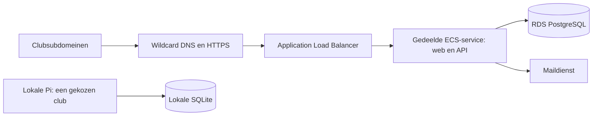

# Multitenant ArrowCast

Status: werkdocument, alleen planning. Er wordt op basis van dit document nog niets geïmplementeerd of gedeployed.

**Planning:** de implementatie wordt voorlopig uitgesteld. Zodra twee à drie clubs interesse hebben in de online variant, kan dit plan als basis voor implementatie worden opgepakt. Dit is geen automatische opdracht om dan te beginnen. Het domein `arrowcast.nl` is al gekocht.

Bijgewerkt: 26 oktober 2026.

Dit document houden we bij als centrale plek voor wensen, voorstellen, besluiten en open vragen. **Vastgelegd** betekent een wens van de gebruiker; **voorstel** en **open** zijn nog te bespreken. Bestaande lokale deploymentafspraken staan in [het Raspberry Pi-plan](../RASPBERRY-PI-PLAN.md).

## 1. Vastgelegde wensen

- Er zijn twee gebruiksvormen: gratis zelf hosten op een Raspberry Pi, of betalen voor de online variant. Competities en logboeken worden niet tussen deze varianten gesynchroniseerd.
- De Pi is in eigen beheer van de club en moet zonder internet kunnen werken. Bij de eerste inrichting voert de beheerder zelf de clubnaam en het bondsnummer van de club in. Het scorelogboek en het organiseren van competities gebruiken vervolgens die club.
- Elke aangesloten club krijgt online een eigen subdomein, bijvoorbeeld `hshilversum.arrowcast.nl`.
- De online omgeving gebruikt Amazon RDS en ECS en wordt met AWS CDK gedeployed.
- De ID van de bestaande publieke hosted zone staat in de AWS-parameter `/nl/arrowcast/public-hosted-zone-id`.
- Autorisatie en tenantisolatie worden voorlopig in de service uitgevoerd, zonder Row-Level Security (RLS). RLS kan later eventueel als extra beschermingslaag worden toegevoegd.
- Eén gebruiker kan lid zijn van meerdere clubs en kan via de URL van iedere club op die tenant inloggen.
- Een clubbeheerder kan via een e-mailadres iemand uitnodigen met een vooraf gekozen rol: beheerder of wedstrijdbeheerder. De backend zoekt op of er voor dat adres een account bestaat. Zonder bestaand account ontvangt de geadresseerde een link om een account aan te maken.
- Deelnemersgegevens, waaronder namen en bondsnummers, en clubgegevens, waaronder clubnummers bij de bond, worden centraal opgeslagen en zijn relevant voor alle clubs.
- De eigenaar van ArrowCast beheert centrale deelnemers, clubs en tenantaanmaak. Een centraal beheersplatform wordt later ontworpen; tenantaanmaak kan aanvankelijk via een beheercommando. Dit centrale beheer betreft de online variant; de Pi blijft zelfstandig.
- Elke deelnemer staat bij precies één club ingeschreven. Gebruikersaccounts kunnen wel meerdere clublidmaatschappen hebben.
- Eigen accountbeheer heeft de voorkeur. Opnieuw inloggen bij een ander clubsubdomein is voorlopig acceptabel; automatische SSO is geen vereiste.
- De online applicatie hoeft aanvankelijk alleen tussen 08:00 en 23:00 beschikbaar te zijn. Tijdzonevoorstel: `Europe/Amsterdam`, inclusief zomer- en wintertijd.
- Boogtypen en blazoenen zijn globaal, zonder afzonderlijke varianten per tenant.

## 2. Huidige situatie in de code

Dit is de uitgangssituatie, geen beschrijving van de gewenste multitenantwerking:

- De API gebruikt Fastify en Drizzle met lokale SQLite-opslag. Queries gebruiken onder andere de synchrone `.get()`- en `.run()`-methoden van de SQLite-driver.
- `clubs` is een clubregister met het clubnummer als primaire sleutel. `participants` bevat een uniek bondsnummer en een verwijzing naar één club.
- `club_settings` bevat één optionele clubkeuze voor de hele installatie. Deze instelling kan in de beheerinterface ook worden gewist; het is nog geen verplichte eerste inrichting.
- `users` gebruikt de gebruikersnaam als sleutel, heeft geen e-mailadres en bevat één algemene rol: `admin` of `competition_manager`.
- Beheerlogin levert een JWT met een gebruikersnaam, algemene rol en sessieversie. Lidmaatschappen per club bestaan nog niet.
- Competities, banen en logboekgegevens hebben geen expliciete tenantkolom. Logboekpincodes zijn gekoppeld aan alleen de deelnemer.
- Score-invoer gebruikt aparte QR-toegang en scoringsessies; een persoonlijk beheeraccount is daarvoor niet vereist.
- De bestaande deploymentbestanden richten zich op de Pi; de online CDK-infrastructuur moet nog worden ontworpen.

Relevante bestanden: [datamodel](../apps/api/src/db/schema.ts), [databaseverbinding](../apps/api/src/db/index.ts), [authenticatie](../apps/api/src/modules/auth/routes.ts), [clubinstelling](../apps/api/src/modules/clubs/routes.ts) en [clubinterface](../apps/web/src/features/settings/Club.tsx).

## 3. Voorgesteld architectuurmodel

### Clubregister en tenant zijn verschillende begrippen

**Voorstel:** een club is een centrale stamrecord; een tenant is de ArrowCast-omgeving van een aangesloten club. Een club uit deelnemersimports hoeft dus nog geen ArrowCast-tenant te hebben.

- Elke tenant hoort bij precies één club. Voor de eerste versie krijgt een club maximaal één online tenant.
- Een stabiele interne `clubId` identificeert de club; bondsnummer en naam zijn aanpasbare kenmerken.
- Een stabiele interne `tenantId` identificeert de omgeving. Het subdomein is een unieke slug, geen primaire sleutel.
- Clubnummer, tenant-ID en slug zijn aparte velden. Een naamswijziging of correctie van een bondsnummer verandert de identiteit van de club niet.
- Een onbekend subdomein maakt nooit automatisch een club of tenant aan.

### Centrale en clubgebonden gegevens

| Gegevens | Voorgestelde scope | Opmerking |
| --- | --- | --- |
| Accounts en geverifieerde e-mailadressen | Centraal online | Eén identiteit voor meerdere clubs |
| Clubregister en bondsidentificatie | Centraal | Inclusief clubs zonder eigen ArrowCast-omgeving |
| Deelnemers: naam en bondsnummer | Centraal | Een deelnemer hoeft geen gebruikersaccount te hebben |
| Relatie deelnemer–club | Centraal | Precies één huidige club per deelnemer; los van accountlidmaatschap |
| Tenant, slug en activatiestatus | Centraal beheerd | Eén actieve omgeving per aangesloten club als startpunt |
| Accountlidmaatschap en beheerrol | Per tenant | `userId + tenantId`, met rol en status |
| Uitnodigingen | Per tenant | Geadresseerd aan een e-mailadres, eventueel al gekoppeld aan een account |
| Clubinstellingen, locaties en banen | Per tenant | De huidige singleton wordt tenantinstelling |
| Competities en wedstrijdregistraties | Per tenant | Organiserende tenant bepaalt eigenaarschap |
| Scores, QR-toegang en scoringsessies | Per tenant | Ook onderliggende records blijven binnen die tenant |
| Logboek, pincodes en invoertokens | Per tenant en deelnemer | Een centrale naam maakt scores of pincodes niet centraal toegankelijk |
| Auditgegevens | Per tenant, met actor | Platformhandelingen krijgen expliciete platformcontext |
| Boogtypen en blazoenen | Globaal | Gedeelde catalogus voor alle online tenants; op de Pi lokaal beschikbaar |

**Belangrijk onderscheid:** een accountlidmaatschap geeft toegang tot clubbeheer. Een deelnemersrelatie geeft aan bij welke club iemand schiet. Die relaties mogen niet automatisch beheerrechten aan elkaar geven.

Een competitie kan deelnemers van andere clubs bevatten. De thuisclub van een deelnemer bepaalt nooit het eigenaarschap van de competitie of de scores. De organiserende tenant doet dat.

### Online database

**Voorstel:** één gedeelde RDS PostgreSQL-database met een gedeeld schema, centrale tabellen en tenanttabellen met `tenant_id`. RDS is vastgesteld; PostgreSQL en dit indelingsmodel zijn voorstellen.

Dit model sluit aan op centrale stamgegevens en vermijdt een aparte database of ECS-service voor iedere club. Het vraagt consequente tenantafbakening bij iedere lees- en schrijfoperatie. Een database per tenant of schema per tenant blijft een alternatief als latere isolatie-eisen dat nodig maken.

De overstap vanaf SQLite is een afzonderlijk werkpakket: een andere database-URL volstaat niet. Driver, schemaspecificaties, synchrone queries, transacties, SQL-verschillen en migraties moeten worden aangepast. Het voorstel is SQLite op de Pi te behouden en domeinlogica en contracten te delen, met opslagimplementaties en migraties voor beide databases.

### Repository en applicatievarianten

Een aparte fork voor de cloudvariant is besproken. **Nog geen besluit:** het eerdere advies is één repository met afzonderlijke Pi- en cloud-API's, gedeelde webinterface, contracten en domeinlogica, en afzonderlijke deploymentpaden. Zo hoeven verbeteringen aan wedstrijdbeheer en scoreberekening niet steeds tussen repositories te worden overgenomen. De keuze voor gratis zelf hosten of betaald online gebruik vereist op zichzelf geen aparte repository.

## 4. Tenant bepalen en rechten controleren

### Online verzoeken

1. Valideer de host tegen de toegestane ArrowCast-domeinen en haal de slug uit bijvoorbeeld `hshilversum.arrowcast.nl`.
2. Zoek de actieve tenant op. Een onbekende of inactieve tenant krijgt geen toegang tot clubfunctionaliteit.
3. Stel de tenantcontext voor dit verzoek vast.
4. Controleer bij beheeracties de ingelogde identiteit, het actieve lidmaatschap en de rol voor deze tenant.
5. Lees of wijzig gegevens uitsluitend binnen die context.

De URL bepaalt welke club wordt bezocht; de URL verleent geen rechten. Een `tenantId` uit requestbody of querystring mag de context niet overschrijven. Doorgegeven hostheaders worden alleen vertrouwd via de ingestelde proxyketen; de huidige localhost-proxyconfiguratie moet voor de AWS-opstelling worden herzien.

### Service-autorisatie als uitgangspunt

**Vastgelegd:** de service verzorgt lidmaatschapscontrole, rollen en tenantfilters. We gebruiken voorlopig geen PostgreSQL Row-Level Security (RLS). Een eventuele toevoeging van RLS is toekomstig werk en geen voorwaarde voor de eerste versie.

**Wat betekent RLS?** Row-Level Security is toegangscontrole op rijniveau in de database zelf. De service geeft bijvoorbeeld door dat het verzoek voor club A is; een databasebeleid laat dan alleen de wedstrijdrijen van A toe. Zonder RLS moet de service die beperking bij iedere query toepassen. RLS kan zo een vergeten tenantfilter opvangen, maar vervangt geen controle op inloggen, clublidmaatschap en rollen. Correct beleid en een betrouwbare tenantcontext blijven nodig. Deze uitleg dient als achtergrond voor een eventuele latere uitbreiding.

Daarbij gelden de volgende ontwerpafspraken:

- Tenantgebonden data wordt via een datalaag benaderd die een tenantcontext vereist. Zonder context wordt de operatie geweigerd.
- Ook ophalen op ID, mutaties, zoekresultaten, totalen, exports, achtergrondtaken en eventuele liveverbindingen worden afgebakend.
- Ouders en kinderen horen bij dezelfde tenant. Gebruik waar passend samengestelde foreign keys zoals `(tenant_id, competition_id)`, zodat een record niet aan een competitie van een andere tenant kan worden gekoppeld.
- Een record uit een andere tenant levert een neutrale niet-gevondenreactie op, zonder gegevens van die club prijs te geven.
- Cachekeys en idempotentiesleutels krijgen tenantcontext waar nodig. Jobs dragen een expliciete tenant-ID mee.
- Publieke resultaten en QR-score-invoer hebben eigen toegangsregels. Hun grants, tokens en sessies moeten eveneens bij de bezochte tenant horen.
- Platformbeheer krijgt expliciete bevoegdheden; een clubbeheerder kan zichzelf geen platformrechten geven.

**Afweging:** service-autorisatie voorkomt dubbele bedrijfsregels, maar een vergeten tenantfilter kan gegevens van andere clubs blootleggen. Relationele constraints helpen tegen onjuiste koppelingen; ze voorkomen geen te brede leesquery. Isolatietests zijn daarom een releasevoorwaarde.

RLS kan later als extra laag worden toegevoegd. PostgreSQL ondersteunt beleid per rij en weigert bij ingeschakelde RLS zonder toepasselijk beleid standaard toegang; onder andere tabeleigenaars omzeilen RLS doorgaans. Een eventuele invoering vraagt daarom ook een passende applicatierol en veilig transactiegebonden tenantgebruik bij connection pooling. Zie [PostgreSQL: Row Security Policies](https://www.postgresql.org/docs/current/ddl-rowsecurity.html).

Netwerkbeveiliging en databaseprivileges blijven ook bij service-autorisatie nodig: de browser en Pi verbinden niet rechtstreeks met RDS, en de gewone API-gebruiker krijgt geen migratie- of beheerrechten.

## 5. Accounts, meerdere clubs en inloggen

**Vastgelegd:** eigen accountbeheer heeft de voorkeur. **Voorstel:** één centraal online account met een interne `userId` en een geverifieerd e-mailadres. Rollen verhuizen van het account naar het tenantlidmaatschap.

- Dezelfde gebruiker kan beheerder bij club A en wedstrijdbeheerder bij club B zijn.
- Een bezoek aan de URL van club B gebruikt de rechten voor B, ook als dezelfde gebruiker bij A meer rechten heeft.
- Zonder lidmaatschap kan de gebruiker geen clubbeheer uitvoeren. Publieke wedstrijdpagina's kunnen wel toegankelijk zijn volgens het publicatiebeleid.
- Intrekken van een lidmaatschap of aanpassen van een rol moet bestaande toegang tot die club ongeldig maken. Vertrouw niet uitsluitend op een oude rolclaim in een JWT.
- Verschillende clubs moeten gelijktijdig in verschillende browsertabbladen werken. Een globale instelling `currentTenant` op het account mag de context van andere tabbladen niet veranderen.

**Vastgelegd:** hetzelfde account wordt op meerdere club-URL's gebruikt. Opnieuw inloggen bij een ander subdomein is voorlopig prima; automatische SSO is geen vereiste voor de eerste versie.

**Voorstel voor de eerste versie:** iedere host gebruikt een eigen sessie met dezelfde centrale accountgegevens. De precieze sessievorm en uitlogscope worden nog ontworpen. Centrale login met redirects kan later worden toegevoegd als naadloos wisselen alsnog gewenst is.

## 6. Uitnodigen van beheerders en wedstrijdbeheerders

**Vastgelegd:** bij uitnodigen kiest de clubbeheerder vooraf een e-mailadres en de rol beheerder (`admin`) of wedstrijdbeheerder (`competition_manager`) voor de betreffende club. De rol hoort bij de uitnodiging en wordt op de server vastgelegd.

**Voorgestelde flow:**

1. Een bevoegde clubbeheerder vult het e-mailadres in en kiest de rol binnen de actieve tenant.
2. De backend normaliseert het adres volgens het accountbeleid en zoekt het centrale account op. Verwijder niet zomaar punten of plustekens uit adressen.
3. De backend maakt een tenantgebonden uitnodiging met de gekozen rol. Als er een account bestaat, wordt de uitnodiging eraan gekoppeld. Er ontstaat nog geen actief lidmaatschap.
4. De ontvanger krijgt een uitnodigingsmail met clubnaam en een eenmalige link. Bij een bestaand account kan de uitnodiging ook na login worden getoond.
5. Een bestaande gebruiker logt in. Zonder bestaand account leidt de link naar accountaanmaak voor het uitgenodigde e-mailadres, met e-mailverificatie. Daarna accepteert de gebruiker de uitnodiging expliciet.
6. Acceptatie maakt het lidmaatschap met de vooraf bepaalde rol in één transactie actief en verbruikt de uitnodiging. De ontvanger kan rol en tenant niet via het registratieformulier of de URL wijzigen. Opnieuw accepteren maakt geen duplicaat.

**Voorgestelde randvoorwaarden:**

- Willekeurig uitnodigingstoken, alleen gehasht opgeslagen; vervaltermijn als startvoorstel zeven dagen.
- Intrekken en opnieuw verzenden zijn mogelijk. Opnieuw verzenden maakt de vorige link ongeldig.
- Eén actief lidmaatschap per account en tenant. Voorstel: een al actief lid verwijzen naar ledenbeheer; een nieuwe uitnodiging wijzigt geen bestaande rol stilzwijgend.
- Uitnodigingen hebben een status zoals `pending`, `accepted`, `revoked` of `expired` en registreren de uitnodiger.
- De response onthult niet onnodig of een willekeurig adres een account heeft. De interne lookup blijft wel onderdeel van de flow.
- Verzendlimieten en auditregistratie horen bij het uitnodigingsproces. Mail versturen gebeurt na het vastleggen van de uitnodiging, met herhaalbare aflevering zonder dubbele lidmaatschappen.
- Een club mag niet onbedoeld zonder laatste actieve beheerder eindigen. De eerste clubbeheerder wordt via een afzonderlijke onboardingprocedure ingesteld.

**Vastgelegd:** een nog onbekend e-mailadres ontvangt een link om een account aan te maken. De vooraf gekozen club en rol blijven daarbij behouden.

## 7. Eerste inrichting op Raspberry Pi

**Vastgelegd:** de gratis installatie is in beheer van de club zelf en werkt zonder internet. De club voert bij de eerste inrichting zelf clubnaam en bondsnummer in; die club geldt voor scorelogboek en competities. Een online tenant, betaald abonnement of goedkeuring vanuit het centrale beheersplatform is daarvoor niet vereist.

**Voorgestelde flow:**

1. De beheerder doorloopt de bestaande eerste login en wachtwoordwijziging.
2. Zolang de installatie geen club heeft, verschijnt verplichte clubinrichting. Clubgebonden functies zijn ook via de API geblokkeerd totdat de inrichting is afgerond.
3. De beheerder voert zelf clubnaam en bondsnummer in. Dit werkt zonder centrale clublijst of internetverbinding.
4. De keuze wordt duurzaam opgeslagen als installatieconfiguratie en gekoppeld aan de lokale tenantcontext.
5. Nieuwe competities en logboekgegevens krijgen automatisch die tenantcontext. De lokale URL hoeft geen clubsubdomein te bevatten.

De huidige optie om de club leeg te maken vervalt in dit voorstel na afronding. De club beheert correcties en eventuele herinrichting zelf; toestemming van platformbeheer is niet nodig. **Nog te ontwerpen:** of wijzigen alleen de clubgegevens corrigeert of een nieuwe inrichting vereist. Bestaande wedstrijden en scores mogen daarbij niet stilzwijgend aan een andere club worden toegeschreven. Het antwoord over eigen beheer bepaalt deze precieze wijzigingsprocedure nog niet.

### Offline gebruik en centrale opslag

**Vastgelegd:** zelf hosten en betaald online gebruik zijn afzonderlijke gebruiksvormen. De Pi blijft zelfstandig bruikbaar zonder internet en deelt geen competities of logboeken met de online omgeving. Ook buiten de online openingstijden blijft de Pi lokaal bruikbaar.

**Voorstel:** lokale SQLite blijft behouden. Clubs en deelnemers worden lokaal opgeslagen; centrale online IDs of cloudregistratie zijn geen voorwaarde voor lokaal gebruik. De bestaande optionele deelnemersimport via internet kan apart blijven bestaan. Er is geen nieuwe automatische koppeling met het centrale ArrowCast-register afgesproken.

**Voorstel:** online accounts en lokale beheeraccounts blijven afzonderlijke identiteiten. Online e-mailuitnodigingen horen bij de cloudvariant; lokaal accountbeheer mag geen internet of centrale accountaanmaak vereisen.

Synchronisatie van competities en logboeken valt buiten dit plan. Er worden ook geen gedeelde beheerrechten of pincodes tussen Pi en online aangenomen. Een eventuele eenmalige overstap/import tussen de gebruiksvormen is een afzonderlijke toekomstige functie, geen doorlopende synchronisatie.

## 8. Beheer van centrale stamgegevens

**Voorstel:** centrale deelnemers en clubs zijn herbruikbare stamgegevens. Clubbeheerders kunnen ze gericht opzoeken en selecteren voor hun eigen wedstrijden. Dit geeft geen toegang tot accounts, andere clublidmaatschappen, privélogboeken of beheerinformatie van andere clubs.

**Vastgelegd:** de eigenaar van ArrowCast beheert deze centrale gegevens via een later te ontwerpen beheersplatform. Dit beheer geldt voor de online variant; lokale Pi-gegevens blijven onder beheer van de club.

- Gebruik stabiele interne IDs en bewaar bondsidentificaties als aparte velden. Bepaal of uniekheid op bondsnummer alleen of op `bond + bondsnummer` geldt.
- Leg bron, importmoment en eventuele handmatige correctie vast. Een import mag een bewuste correctie niet ongemerkt overschrijven.
- Alleen platformbeheer wijzigt centrale clubs en deelnemers. Eventuele imports of correctieverzoeken worden later als onderdeel van dat beheer ontworpen; clubbeheerders hebben geen directe centrale schrijfrechten.
- Elke deelnemer verwijst naar precies één huidige club. Een model voor gelijktijdige inschrijving bij meerdere clubs is niet nodig. Een clubwissel past die verwijzing aan; eventuele historie staat los van de huidige inschrijving.
- Bewaar waar nodig de wedstrijdnaamgegevens en vertegenwoordigde club als momentopname bij de inschrijving, zodat een latere clubwissel historische uitslagen niet herschrijft.
- Spreek af hoe dubbele deelnemers worden samengevoegd en hoe correcties of verwijderingen doorwerken binnen de online omgeving. Automatische doorwerking naar zelfstandige Pi-installaties valt buiten dit plan.
- Beperk centraal zoeken tot de benodigde velden; toegang tot het register betekent geen onbeperkte openbare export.
- Boogtypen en blazoenen vormen globale catalogi. **Voorstel:** online wijzigingen lopen via platformbeheer; op de Pi blijven de catalogi lokaal beschikbaar zonder online afhankelijkheid.

### Tenantaanmaak en centraal beheersplatform

**Vastgelegd:** de eigenaar van ArrowCast maakt online tenants aan. Het centrale beheersplatform is geen voorwaarde om met de eerste clubs te starten: tenantaanmaak kan aanvankelijk via een beheercommando. Er is geen publieke selfserviceregistratie voor nieuwe tenants afgesproken.

Het toekomstige beheercommando zoekt een club op of maakt deze aan, maakt een tenant met een unieke slug aan en nodigt de eerste clubbeheerder uit. Het commando moet nog worden gebouwd; naam en argumenten zijn nog niet vastgelegd. Onder het voorgestelde model met wildcard-DNS en een gedeelde ECS-service is per tenant geen afzonderlijke infrastructuurdeployment nodig.

**Ontwerpvoorstel:** het beheercommando en het latere beheersplatform gebruiken dezelfde logica voor tenantaanmaak, validatie en uitnodigingen. Zo kan de eerste online versie zonder beheerinterface starten.

Dit toekomstige systeem beheert centrale clubs, deelnemers en tenantaanmaak. **Voorstel voor onboarding:** de eigenaar koppelt een tenant aan een club, kiest een unieke slug en nodigt de eerste clubbeheerder uit. Hoe de eerste beheerder precies wordt aangewezen en hoe betaling/activatie werken, is nog te ontwerpen. Een clubrecord alleen activeert geen tenant.

## 9. Online infrastructuur met CDK

**Vastgelegd:** ECS, RDS en deployment met CDK; aanvankelijk is beschikbaarheid alleen tussen 08:00 en 23:00 vereist. Onderstaande invulling is een voorstel.

Pi en cloud zijn afzonderlijke gebruiksvormen; er is geen synchronisatieverbinding voor competities en logboeken.

- Wildcard DNS voor `*.arrowcast.nl` naar één Application Load Balancer, met een ACM-certificaat voor deze subdomeinen. Het hoofddomein wordt apart meegenomen als het ook door deze omgeving wordt bediend.
- **Vastgelegd:** de bestaande publieke hosted zone wordt hergebruikt; de hosted zone-ID staat in de AWS-parameter `/nl/arrowcast/public-hosted-zone-id`. Het CDK-ontwerp gebruikt deze parameter als verwijzing naar de zone, in plaats van een nieuwe zone aan te maken of de ID hard te coderen. AWS-account en regio voor het uitlezen van de parameter worden bij het deploymentontwerp vastgelegd. De parameterwaarde is voor dit plan niet opgehaald of gecontroleerd.
- Eén gedeelde ECS-service, bij voorkeur Fargate, met tenantresolutie in de API. Een nieuwe club vraagt dan een tenantrecord en slug, geen eigen ECS-deployment.
- Web en API onder dezelfde cluborigin; relatieve API-URL's blijven bruikbaar.
- RDS in private subnets. Alleen de API en een gecontroleerde migratietaak kunnen via toegestane security groups verbinden. Secrets worden buiten de broncode beheerd.
- ECS-taken zijn vervangbaar. Sessies en andere noodzakelijke gedeelde status mogen niet uitsluitend in taakgeheugen of op een lokale containerdisk staan.
- CDK beheert netwerk, certificaatkoppeling, load balancer, ECS, RDS, IAM, secretskoppelingen, logging en DNS waar de zone beschikbaar is.
- Omgevingen krijgen afzonderlijke databases en secrets. Productiedata krijgt back-ups, herstelafspraken en bescherming tegen onbedoeld verwijderen.
- Databasemigraties draaien gecontroleerd als aparte releasestap, niet gelijktijdig bij het starten van iedere ECS-replica. Schemawijzigingen moeten passen bij een rolling deployment.
- Mailprovider, AWS-regio, capaciteit, Multi-AZ, uitgaand netwerkverkeer en budget worden voor uitvoering gekozen. Er is nog geen kostenraming.
- Technische healthchecks hebben geen clubhost nodig en geven geen clubdata terug. Platform- en authenticatiehosts worden expliciet gereserveerd.

### Beschikbaarheid van 08:00 tot 23:00

**Vastgelegd:** de online applicatie hoeft aanvankelijk alleen in dit tijdvenster beschikbaar te zijn. Dit vereist geen harde uitschakeling om 23:00; het geeft ruimte voor onderhoud of kostenbesparing buiten het venster. **Voorstel:** dagelijks in tijdzone `Europe/Amsterdam`, inclusief automatische aanpassing voor zomer- en wintertijd.

- Onderzoek geplande ECS-scaling naar nul buiten het tijdvenster en tijdig opschalen vóór 08:00. Houd rekening met opstarttijd en healthchecks; om 08:00 moet de dienst al bruikbaar zijn. AWS ondersteunt [geplande ECS-scaling](https://docs.aws.amazon.com/AmazonECS/latest/developerguide/service-autoscaling-schedulescaling.html).
- Ontwerp voor het geval van nachtelijke uitschakeling een melding met openingstijden. Bepaal hoe actieve wedstrijdinvoer, lopende verzoeken en achtergrondtaken rond sluiting worden afgehandeld voordat het schema wordt ingevoerd.
- Beslis afzonderlijk of RDS blijft draaien. Stoppen en starten kan bij geschikte configuraties, maar de [RDS-opstarttijd](https://docs.aws.amazon.com/AmazonRDS/latest/UserGuide/USER_StartInstance.html) kan volgens AWS variëren van minuten tot uren. Een dagelijkse start vlak vóór 08:00 is daardoor geen voldoende beschikbaarheidsplan.
- Vergelijk vóór uitvoering de besparing met de extra complexiteit. Bij gestopte RDS blijven [opslag- en back-upkosten](https://docs.aws.amazon.com/AmazonRDS/latest/UserGuide/USER_OnDemandDBInstances.html) bestaan; het tijdvenster betekent geen kosteloze nachtelijke infrastructuur.
- Leg later vast of het toekomstige centrale beheersplatform dezelfde openingstijden krijgt. De lokale Pi is niet afhankelijk van dit schema.

AWS ondersteunt hostgebaseerde routering met meerdere subdomeinen via één ALB: [host conditions](https://docs.aws.amazon.com/elasticloadbalancing/latest/application/rule-condition-types.html). Een wildcardcertificaat dekt één niveau subdomeinen en niet automatisch het hoofddomein: [ALB-certificaten](https://docs.aws.amazon.com/elasticloadbalancing/latest/application/https-listener-certificates.html). Netwerktoegang tot RDS kan via security groups worden beperkt: [RDS in een VPC](https://docs.aws.amazon.com/AmazonRDS/latest/UserGuide/USER_VPC.Scenarios.html). CDK ondersteunt het definiëren van ECS/Fargate-infrastructuur: [AWS CDK](https://docs.aws.amazon.com/cdk/v2/guide/). Deze mogelijkheden ondersteunen het voorstel; ze leggen onze infrastructuurkeuzes nog niet vast.

## 10. Voorgestelde volgorde van uitvoering

Dit is toekomstig werk. Voor nu wordt alleen dit plan bijgehouden.

1. **Resterende kernkeuzes afronden:** repository-indeling, tenantmodel en sessieontwerp voor eigen accountbeheer. De zelfstandige Pi, afwezigheid van synchronisatie, rollen bij uitnodiging, centraal eigenaarschap van stamgegevens en service-autorisatie zonder RLS zijn vastgelegd.
2. **Datamodel en migratie ontwerpen:** centrale IDs, tenants, lidmaatschappen, e-mailverificatie, uitnodigingen en tenantkolommen. Maak vooraf een back-up- en terugvalplan.
3. **Tenantcontext en datalaag invoeren:** service-autorisatie voor beheer én publieke scorepaden; bepaal tegelijk hoe PostgreSQL en SQLite worden ondersteund.
4. **Bestaande Pi-data behouden:** ontwerp een lokale schema-upgrade die bestaande wedstrijden, logboek en accounts bewaart en zo nodig de ontbrekende clubgegevens laat invullen. Een bestaande Pi hoeft niet naar de cloud te worden overgezet; een interne tenant-ID op de Pi is een implementatiekeuze, geen online registratie.
5. **Pi-inrichting aanpassen:** verplichte invoer van clubnaam en bondsnummer, backendblokkade vóór inrichting en clubbeheer zonder centrale afhankelijkheid.
6. **Online account- en clubbeheer bouwen:** eigen accountbeheer, rollen per club, uitnodigen met vooraf gekozen rol, registratie, accepteren en intrekken. Ontwerp daarnaast later het centrale beheersplatform voor stamgegevens, tenantaanmaak en eerste beheerder.
7. **AWS-omgeving toevoegen:** CDK, DNS/TLS, ECS, RDS, mail, migraties, observatie, herstelprocedures en een beschikbaarheidsplan voor 08:00–23:00.
8. **Pilot met twee clubs en een Pi:** aantonen dat clubgrenzen, verschillende rollen en offline lokale werking kloppen voordat de online omgeving breder wordt gebruikt.

### Acceptatiecriteria voor latere implementatie

- Een nieuwe Pi kan geen competitie of logboekinvoer starten voordat clubnaam en bondsnummer zijn ingevoerd; na herstart blijven die gegevens bestaan. Inrichting en lokaal gebruik werken zonder internet, online tenant of betaald abonnement.
- Club A kan geen beheerdata van B lezen of wijzigen via gewijzigde IDs, filters, exports, QR-tokens of scoringsessies.
- Een gebruiker met lidmaatschappen bij A en B krijgt op iedere URL uitsluitend de rol van die tenant, ook in twee gelijktijdige tabbladen.
- Het intrekken van toegang bij A beïnvloedt toegang bij B niet en blokkeert verdere beheeracties bij A.
- Een uitnodiging verleent pas na geldige acceptatie rechten, uitsluitend bij de bedoelde club en met de vooraf gekozen rol. Een onbekend adres kan via de link een account aanmaken; rol en tenant zijn daarbij niet door de ontvanger te wijzigen. Verlopen, ingetrokken of gebruikte links geven geen nieuwe toegang.
- Iedere deelnemer heeft precies één huidige club, maar kan deelnemen aan competities van andere organiserende clubs, zonder dat scores of pincodes tussen tenants zichtbaar worden.
- Clubbeheerders kunnen centrale clubs, deelnemers en globale catalogi raadplegen, maar centrale clubs en deelnemers alleen via platformbeheer laten wijzigen. Alleen platformbeheer maakt online tenants aan.
- Clubwissels in stamgegevens veranderen de eigenaar van historische wedstrijden en logboeken niet.
- Een onbekende host, ontbrekende tenantcontext of gemanipuleerde proxyheader levert geen clubtoegang op.
- Pi-kernflows werken lokaal op SQLite; cloudkernflows werken op de gekozen RDS-engine. De online variant blijft correct bij meerdere ECS-taken en herstarts.
- Een bestaande Pi-database kan met behoud van gegevens worden gemigreerd en een back-up kan aantoonbaar worden hersteld.
- De online applicatie is tussen 08:00 en 23:00 beschikbaar in de nog te bevestigen tijdzone; een eventueel opstartschema is ook bij zomer- en wintertijd gecontroleerd. De Pi blijft buiten dat venster zelfstandig bruikbaar.

## 11. Antwoorden en resterende besluiten

De oorspronkelijke nummers blijven behouden om antwoorden te kunnen terugvinden.

| Nr. | Onderwerp | Antwoord / status |
| --- | --- | --- |
| O1 | Offline Pi | Vastgelegd: ja, zonder internet bruikbaar |
| O2 | Pi en online delen competities/logboeken | Vastgelegd: nee; gratis zelf hosten óf betaald online gebruik |
| O3 | Eerste clubinrichting Pi | Vastgelegd: zelf clubnaam en bondsnummer opvoeren |
| O4 | Inloggen op een ander subdomein | Vastgelegd: opnieuw inloggen is voorlopig acceptabel; SSO niet vereist |
| O5 | Uitnodigen zonder bestaand account | Vastgelegd: accountaanmaak via e-maillink; beheerder of wedstrijdbeheerder vooraf bepaald |
| O6 | Centrale clubs en deelnemers beheren | Vastgelegd: door de eigenaar van ArrowCast, via een later te ontwerpen beheersplatform |
| O7 | Aantal clubs per deelnemer | Vastgelegd: precies één huidige club; accountlidmaatschappen blijven meervoudig mogelijk |
| O8 | Authenticatie | Voorkeur vastgelegd: eigen accountbeheer; technisch sessieontwerp nog uitwerken |
| O9 | RLS naast service-autorisatie | Vastgelegd: voorlopig geen RLS; autorisatie en tenantisolatie in de service. RLS kan later eventueel worden toegevoegd |
| O10 | Tenantaanmaak | Vastgelegd: door de eigenaar; aanvankelijk mogelijk via beheercommando, later via centraal beheersplatform. Commandodetails en onboarding nog ontwerpen |
| O11 | Beheer Pi / clubwijziging | Vastgelegd: gratis, in beheer van de club zelf. Precieze correctie- en herinrichtingsprocedure nog ontwerpen |
| O12 | Beschikbaarheid en AWS-configuratie | Vastgelegd: aanvankelijk alleen 08:00–23:00 nodig. Tijdzonevoorstel Europe/Amsterdam; infrastructuur, nachtelijke scaling en budget nog uitwerken |
| O13 | Boogtypen en blazoenen | Vastgelegd: globaal; centrale wijzigingsrechten nog ontwerpen |

Aanvullend open: definitieve keuze voor fork of één repository met twee API-varianten; RDS-engine en schema-indeling; betaling/activatie van online abonnementen. Het centrale beheersplatform krijgt later een eigen ontwerp.

## 12. Besluitgeschiedenis

| Datum | Vastgelegd |
| --- | --- |
| 2026-10-26 | Eerste plan aangemaakt met de wensen uit §1. Overige architectuurkeuzes zijn voorstellen of open vragen; er is nog niets gebouwd. |
| 2026-10-26 | Antwoorden O1–O13 verwerkt: gratis zelfstandige Pi versus betaald online, geen competitie-/logboeksynchronisatie, handmatige clubinrichting, rollen vooraf bij uitnodigen, centraal beheer door de eigenaar, één club per deelnemer, voorkeur eigen accounts, beschikbaarheid 08:00–23:00 en globale catalogi. RLS toegelicht en nog open; clubwijzigingsprocedure blijft te ontwerpen. Fork besproken, nog niet gekozen. |
| 2026-10-26 | O9 besloten: voorlopig geen RLS. De service verzorgt autorisatie en tenantisolatie; RLS blijft een mogelijke latere uitbreiding. |
| 2026-10-26 | Bestaande publieke hosted zone vastgelegd via AWS-parameter `/nl/arrowcast/public-hosted-zone-id`; het CDK-plan hergebruikt deze zone. |
| 2026-10-26 | Implementatie uitgesteld totdat twee à drie clubs interesse hebben in de online variant. Domein arrowcast.nl is al gekocht. Tenantaanmaak kan aanvankelijk via een nog te bouwen beheercommando; het centrale beheersplatform hoeft daarvoor nog niet beschikbaar te zijn. |
